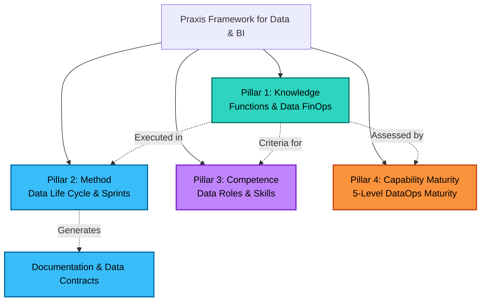

# Praxis Framework: Integrated P3M Knowledge & Method Vault
## Specializing P3M for Data Engineering, Analytics & Business Intelligence

> [!INFO] Welcome to the Praxis Framework Knowledge Vault
> **Praxis** is the free, community-driven, integrated framework for project, programme, and portfolio management (P3M). It uniquely combines **Knowledge**, **Method**, **Competency**, and **Capability Maturity** into a single cohesive taxonomy.
> 
> *This vault bridges the gap between traditional project governance and modern data platforms (Databricks, Snowflake, Microsoft Fabric, dbt, Power BI, Unity Catalog), providing actionable P3M for data pipelines, lakehouse architectures, semantic models, and executive BI.*
>
> **Flagship Guide**: **[[Praxis for Data and BI|Read the Praxis for Data & Business Intelligence Practitioner Guide]]**

---

## The Four Pillars Architecture

---

## Project & Programme Life Cycle for Data & Analytics

Data and BI initiatives adapt the single Praxis life cycle model into an agile, iterative progression:

```mermaid
flowchart LR
    classDef proc fill:#38bdf8,stroke:#0369a1,color:#000;
    classDef doc fill:#f43f5e,stroke:#be123c,color:#fff;
    
    MAN[Strategic KPI Need]:::doc --> ID[Identification: Data Audit]:::proc
    ID --> BR[Brief & Data Feasibility]:::doc
    BR --> DEF[Definition: Lakehouse Design]:::proc
    DEF --> BC[Data Contracts & FinOps Plans]:::doc
    BC --> DEL["Delivery: Medallion Sprints<br>Bronze → Silver → Gold"]:::proc
    DEL --> PROD[Certified BI Models]:::doc
    PROD --> CLO[Closure: DataOps Handover]:::proc
    CLO --> BEN[Realized Decision Velocity]:::doc
```

---

## Vault Maps of Content (MOCs)

### Pillar 1: Knowledge
The functional building blocks of P3 management, divided into contextual functions and management functions.

| Domain MOC | Key Topics & Notes | Notes Count |
| :--- | :--- | :--- |
| **[[01. Core Concepts/00 - Overview\|01. Core Concepts]]** | [[1. Knowledge]], [[2 Method]], [[3 Competence]], [[4 Maturity]], [[Complexity]], [[Context]], [[Environment]], [[Life Cycle]] | 31 |
| **[[02. Governance & Framework/00 - Overview\|02. Governance & Framework]]** | [[Governance]], [[Assurance]], [[Sponsorship]], [[Planning]], [[Mandate]] | 9 |
| **[[04. Management Areas/00 - Overview\|04. Management Areas]]** | The 10 Core Functional Domains: Risk, Scope, Schedule, Cost, Resource, Quality, Change, Communication, Stakeholder | 64 |
| **[[10. General Principles/00 - Overview\|10. General Principles]]** | [[Ethics]], [[General Principles of Organisation Management]] | 2 |
| **[[11. Investment & Benefits/00 - Overview\|11. Investment & Benefits]]** | [[Investment Appraisal]], [[General Principles of Funding]], [[Manage Benefits]], [[Realise Benefits]] | 9 |

---

### Pillar 2: Method & Delivery
The structured life cycle processes and documentation supporting projects, programmes, and portfolios.

| Domain MOC | Key Topics & Notes | Notes Count |
| :--- | :--- | :--- |
| **[[03. Processes/00 - Overview\|03. Processes]]** | [[Project & Programme Management]], [[Context of Governance process]], Life Cycle Gateways | 11 |
| **[[06. Documentation & Artefacts/00 - Overview\|06. Documentation & Artefacts]]** | [[Management Plans]], [[Daily Log]], [[Issue Register]], [[Lessons Log]], [[Change log]], [[Progress Report]] | 25 |
| **[[07. Portfolio Management/00 - Overview\|07. Portfolio Management]]** | [[Projects, Programmes And Portfolios]], [[Initiate A Portfolio]], [[Co-ordinate A Portfolio]], [[Communities Of Practice]] | 11 |
| **[[08. Delivery & Lifecycle/00 - Overview\|08. Delivery & Lifecycle]]** | [[Delivery Process]], [[Mobilisation]], [[Solutions Development]], [[Conflict Management]], [[Close a project or programme]] | 15 |

---

### Pillar 3: Competence
Clear performance and knowledge criteria defining the skills required of individuals at Level 2 capability maturity.

| Domain MOC | Key Topics & Notes | Notes Count |
| :--- | :--- | :--- |
| **[[05. Competencies & Skills/00 - Overview\|05. Competencies & Skills]]** | [[Competence]], [[Leadership]], [[Negotiation]], [[Influencing]], [[Delegation]], [[Teamwork]], [[Delivery Competencies]] | 16 |

---

### Pillar 4: Capability Maturity
The five-level maturity model providing benchmarks for organizational P3M capability.

| Domain MOC | Key Topics & Notes | Notes Count |
| :--- | :--- | :--- |
| **[[09. Maturity Models/00 - Overview\|09. Maturity Models]]** | [[Capability Maturity]], [[Maturity Level 1]], [[Maturity Level 2 & 3]], [[Maturity Level 4 & 5]] | 9 |

---

## The 10 Management Areas Cross-Reference Matrix for Data & BI

Every management area intersects all four pillars of the framework:

| Management Area | Knowledge & Data Context | Management Plan | Register / Artefact | Individual Competency | Maturity Benchmark |
| :--- | :--- | :--- | :--- | :--- | :--- |
| **Risk** | [[General Principles of Risk Management\|Risk Guide]]: Schema drift, silent data corruption, pipeline SLA breaches | [[Risk Management Plan]] | [[Risk Register]] | [[Manage Risk Competency\|Manage Risk]] | [[Risk Management Capability Maturity\|Risk Maturity]] |
| **Scope** | [[Scope Management\|Scope Guide]]: Medallion scoping (Bronze/Silver/Gold), Semantic Models, Data Contracts | [[Scope Management Plan]] | [[Product Documents]] | [[Manage Scope]] | [[Requirements Management\|Requirements Maturity]] |
| **Schedule** | [[General Principles of Schedule Management\|Schedule Guide]]: Spike-driven EDA, pipeline iteration cadences | [[Schedule Management Plan]] | [[Delivery Plan]] | [[Manage The Schedule Competency\|Manage Schedule]] | [[Schedule Management\|Schedule Maturity]] |
| **Cost & Finance** | [[General Principles of Financial Management\|Finance Guide]]: Data FinOps, Databricks DBUs, compute tier management | [[Finance Management Plan]] | [[Investment Appraisal]] | [[Develop Budgets And Control Costs]] | [[Financial Management\|Financial Maturity]] |
| **Stakeholder** | [[General Principles of Stakeholder Management\|Stakeholder Guide]]: Managing expectations between engineers and business executives | [[Stakeholder Management Plan]] | [[Stakeholder Register]] | [[Manage Stakeholders Competency\|Manage Stakeholders]] | [[Stakeholder Management\|Stakeholder Maturity]] |
| **Communication** | [[General Principles of Information Management\|Info Guide]]: Data cataloging, lineage tracking, and metadata access | [[Information Management Plan]] | [[Communication Plan]] | [[Communicate Competency\|Communicate]] | [[Information Management\|Info Maturity]] |
| **Resource** | [[General Principles of Resource Management\|Resource Guide]]: Data Engineers, Analytics Engineers (dbt), BI Developers, Data Stewards | [[Resource Management Plan]] | [[Resource Scheduling]] | [[Manage Resources]] | [[Resource Management Capability Maturity\|Resource Maturity]] |
| **Procurement** | [[Procurement\|Procurement Guide]]: SaaS connectors, cloud warehouse licenses, vendor SLAs | [[Contract Management]] | [[Specification]] | [[Manage Contracts]] | [[Procurement Overall Goal\|Procurement Goal]] |
| **Change** | [[Goal of Change Management\|Change Guide]]: Overcoming shadow Excel addiction, self-service BI adoption | [[Change Management Artefact]] | [[Change log]] | [[Manage Change Competency\|Manage Change]] | [[Change Management Capability Maturity\|Change Maturity]] |
| **Quality & Control** | [[Control\|Control Guide]]: DataOps automated testing (freshness, completeness, validity) | [[Control Management Plan]] | [[Issue Register]] | [[Exercise Control Competency\|Exercise Control]] | [[Delivery Process Maturity\|Control Maturity]] |

---

## Recommended Study & Implementation Pathway

1. **Foundations**: Start with [[Complexity]], [[Context]], and [[Life Cycle]] in [[01. Core Concepts/00 - Overview|Core Concepts]].
2. **The Method**: Master the life cycle progression through [[Identification Process]], [[Definition Process]], [[Delivery Process]], and [[Closure Process]].
3. **The Artefacts**: Learn how to assemble [[Management Plans]], maintain the [[Risk Register]] and [[Issue Register]], and report progress with [[Progress Report]]s.
4. **Competency Development**: Review individual performance criteria in [[05. Competencies & Skills/00 - Overview|Competencies & Skills]].
5. **Organizational Maturity**: Benchmark your team using [[Capability Maturity]] in [[09. Maturity Models/00 - Overview|Maturity Models]].

---

## External Resources & Attribution
- Official Praxis Framework Website: [www.praxisframework.org](https://www.praxisframework.org)
- License: Creative Commons Attribution-ShareAlike (CC BY-SA)
