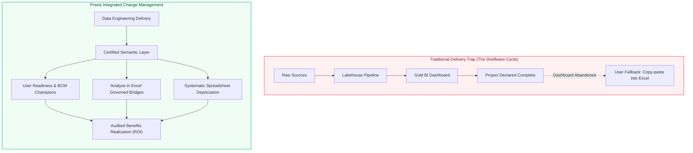

> [!NAV] Navigation
> **Vault**: [[00 - Praxis Framework Overview|Praxis Overview]] > **Section**: [[00 - Overview|Change Management]]
> **Pillar**: Knowledge | **Type**: `management-area`

# Comprehensive Study Notes: Change Management

## General Principles of Change Management

- **Definition**: The achievement of benefits in a business case often requires changes to the working practices of the host organisation. These new working practices are known as **outcomes**. Moving from the current way of working to the desired future outcome is achieved through **change management**.

- Outcomes usually include a section of the organisation adopting and utilising the outputs of one or more projects.

### The Goals of Change Management

- The primary goals of this function are to:

    1. Define the **organisational change** required to convert project outputs into business benefits.

    2. Ensure the organisation is **prepared** to implement the change.

    3. **Implement** the change and **embed** it into normal organisational practice.

### Understanding and Managing Resistance to Change

- Organisations and individuals respond to change in many different ways. **Resistance to change is a natural phenomenon**.

- Managing this change in a controlled and empathetic manner is essential if the benefits promised in the business case are to be realised.

- One way of understanding how an organisation may react to change is through metaphors. Gareth Morgan identified eight metaphors that liken an organisation to, for example, machines (rigid, process-driven), brains (learning, adaptive), or organisms (responsive to the environment).

- Different change management models (e.g., from Kotter, Carnall, or Lewin) are often appropriate for different types of organisational metaphors.

## The Change Management Procedure

1. **Plan**:

    - This step produces the **change management plan**, which defines the principles of how organisational change should be managed.

    - Since change is both central to achieving benefits and one of the hardest things to manage well, this is a key document. It must be closely aligned with other management plans, such as those for stakeholder management and risk management.

2. **Initiate**:
    - This step ensures that the resources needed to manage change, such as Business Change Managers (BCMs), are in place.

3. **Assess Readiness**:

    - This involves determining the nature of the organisation and predicting its likely response to the proposed change.

    - Existing embedded behaviours are considered, along with the organisation’s readiness and willingness to implement the change.

4. **Prepare for Change**:

    - This involves promoting a clear vision for the future and gaining support for it.

    - This work normally forms part of the **identification and definition processes** of a project or programme, where stakeholder management is used to gain support for the high-level business case.

    - It also includes establishing the governance and roles to support the change, such as the appointment of BCMs.

5. **Implement Change**:
    - This is the heart of the procedure. It includes communicating and promoting the benefits of the change, removing obstacles, and co-ordinating the activities that transform business-as-usual from the current practices to the required outcomes.

6. **Sustain Change**:

    - For changes to deliver their full benefits, they have to be **embedded**—they must become stable and the normal way of working.

    - This step will often continue well beyond the P3 life cycle to ensure that value is continually realised from the investment.

### The "Formula for Change"

- The organisation's readiness for change is a key factor in the success of the "Implement" step. This readiness can be represented by a simple formula: **C = (A x B x D) > X**

    - **C** is the likely success of the change.

    - **A** is the level of **dissatisfaction** with the current situation.

    - **B** is the **desirability** of the proposed change (the vision for the future).

    - **D** is the **practicality** of the proposed change (the first concrete steps).

    - **X** is the perceived cost of the change (financial, emotional, etc.).

- The more the combination of A, B, and D exceeds the cost of the change (X), the more likely it is that the change will succeed. If any of A, B, or D is zero, the product is zero, and the change will fail.

## Change Management in Projects, Programmes, and Portfolios

### Projects vs. Programmes

- The inclusion of significant change management is often seen as the deciding factor in whether work should be considered a project or a programme.

- Many sources claim that projects only deliver outputs and that any work involving change management to realise benefits _must_ be a programme.

- However, reality is rarely that simple.

    - A piece of work that delivers a **single output**, leading to **small-scale change** and a resultant benefit, is probably best considered to be a **project** (with an extended life cycle).

    - Work that covers **multiple outputs, complex change**, and numerous different benefits is undoubtedly a **programme**.

    - There is no absolute, set point of distinction between the two.

### Programmes

- A characteristic of a complex programme is that it is not easy to predict all the necessary change at the outset. The concepts of a **vision** and a **blueprint** form an essential part of the "assess" and "prepare" steps of the procedure, with detailed change management plans evolving with the programme.

- **"Islands of Stability"**: A frequent obstacle to change arises from the sheer volume of change imposed on individuals or business units from multiple sources. The programme management team should structure the **tranches** of the programme and co-ordinate the project schedules to ensure that change comes in manageable pieces, interspersed with periods of stability.

### Portfolios

- **Standard Portfolios**: These are not normally focused on a co-ordinated set of benefits and may not include any change management at all (e.g., a construction company’s portfolio of unrelated client contracts).

- **Structured Portfolios**: A structured portfolio involves **co-ordinating the change management plans** of all its component projects and programmes to ensure that they work together effectively.

- The portfolio team must be aware of the cumulative impact of change on the organisation. For example, if multiple projects and programmes are imposing change on a single business unit simultaneously, this can have a negative effect, either because the unit cannot accommodate that level of change or because the multiple changes conflict with each other. The portfolio team is responsible for managing this overall "change capacity".

## Praxis for Data & Business Intelligence: Managing Analytics Adoption

In enterprise Data Engineering, Data Analytics, and Business Intelligence (BI) initiatives, change management is frequently the single determinant of project success. A mathematically flawless Lakehouse pipeline and an aesthetically polished dashboard deliver zero business value if operational teams continue running business-critical processes on unversioned desktop spreadsheets.

> [!IMPORTANT] The Analytics Adoption Paradox
> In software engineering, users are forced to interact with the new interface to perform their daily duties (e.g., ERP entry, CRM updates). In Data & BI, stakeholders have a frictionless, entrenched fallback: **Shadow IT and Excel**. Therefore, Data Project Managers must treat business change management as an active engineering workstream, not an afterthought following production deployment.

### 1. Applying the Formula for Change to Data Projects: $C = (A \times B \times D) > X$

The Praxis change formula provides a diagnostic model for overcoming user inertia against new data platforms:

| Element | Definition in Data & BI Context | Tactical Project Management Interventions |
| :--- | :--- | :--- |
| **$A$ (Dissatisfaction)** | Frustration with the current fragmented data state | Audit and quantify the weekly hours finance and operations spend manually merging CSVs; surface embarrassing metric reconciliations where two departments report different revenue figures to the board. |
| **$B$ (Desirability)** | The compelling vision of a governed Single Source of Truth (SSOT) | Showcase automated morning refreshes, instantaneous drill-down capability, sub-second query performance on massive datasets, and proactive Slack/Teams anomaly alerts. |
| **$D$ (Practicality)** | Frictionless initial steps into the new ecosystem | Deliver bite-sized vertical MVP reports rather than monolithic 20-page dashboards; conduct weekly "Data Office Hours"; provide pre-built templates for recurring weekly meetings. |
| **$X$ (Perceived Cost)** | Friction, learning curve, and loss of perceived control | Overcome the fear of "central IT bottlenecking" by offering self-service exploration workspaces and live connections back to Excel. |

---

### 2. Taming "Excel Addiction" and Deprecating Shadow IT

Business users do not cling to spreadsheets out of malice; they do so because spreadsheets provide autonomy, rapid iteration, and immediate flexibility. Forcing users off spreadsheets abruptly leads to covert resistance and shadow databases (Access, local SQLite, or unauthorized Google Sheets).

Praxis recommends a graduated four-stage migration strategy:

1. **Stage 1: Ingest & Automate (Mirroring)**: Replicate manual spreadsheet logic inside automated Silver/Gold transformation pipelines (dbt/SQL). Verify calculations with users to establish baseline parity.
2. **Stage 2: The Governed Bridge ("Analyze in Excel")**: Rather than forcing business analysts into a new web dashboard interface immediately, configure XMLA endpoints or Power BI / Tableau "Analyze in Excel" connections. Analysts query certified, enterprise-scale semantic models from inside their familiar Excel pivot interface, eliminating local data scraping while maintaining analytical comfort.
3. **Stage 3: The Certified Dashboard Migration**: Transition routine operational reporting to managed web dashboards with scheduled delivery, automated row-level security (RLS), and interactive slicing.
4. **Stage 4: Formal Deprecation and Audit Lock**: Cease email distribution of raw CSV extracts; revoke database credentials for direct read-replicas; redirect upstream source extracts strictly to the central data lakehouse.

---

### 3. Business Change Managers (BCMs) in Modern Data Teams

In complex data transformations, the Project Manager must partner with dedicated Business Change Managers or **Data Product Owners** embedded within business units:

- **Departmental Data Champions**: Identify analytical super-users in Finance, Supply Chain, and Marketing. Train them early on dbt semantic layer concepts, DAX measures, and metadata definitions. They become the first line of peer-to-peer change support.
- **Enterprise Data Literacy Programs**: Partner with business leadership to institute literacy workshops covering metric provenance, statistical variation vs. actual trends, and proper data interpretation.
- **Usage Telemetry & Sunsetting**: Track dashboard telemetries (e.g., Power BI Activity Logs, Snowflake query history, Tableau Server telemetry). If a production report has fewer than 5 active monthly users 90 days post-launch, initiate a formal review to either retrain users or decommission the pipeline, preventing expensive compute drift and technical debt.

---

## Flashcard Q&A

- **Q:** What is an "outcome" in the context of change management?
    - **A:** The new working practices that an organisation adopts and utilises as a result of a change.

- **Q:** What are the three primary goals of change management?
    - **A:** 1. Define the required organisational change, 2. Ensure the organisation is prepared for the change, and 3. Implement and embed the change into practice.

- **Q:** What is the "formula for change" and what does it represent?
    - **A:** C = (A x B x D) > X. It represents the idea that the success of a change (C) depends on the combination of Dissatisfaction with the present (A), Desirability of the future (B), and the Practicality of the first steps (D) being greater than the perceived Cost of the change (X).

- **Q:** Is change management exclusively a programme management function?
    - **A:** No. While it is a defining characteristic of programmes, a simple project delivering a single output that requires small-scale change can also include change management as part of an extended project life cycle.

- **Q:** What is the key change management role of a structured portfolio?
    - **A:** To co-ordinate the change management plans of all its component projects and programmes to manage the overall "change capacity" of the organisation and ensure the cumulative impact of change on business units is manageable.

---
## Navigation & Related Notes
- **Up**: [[00 - Overview|Change Management Overview]]
- **Previous**: [[Control Scope Change]]
- **Next**: [[Manage Change]]

### Related Concepts & Artefacts
- [[00 - Praxis Framework Overview|Praxis Framework Master MOC]]
- [[Capability Maturity]]
- [[Complexity]]
