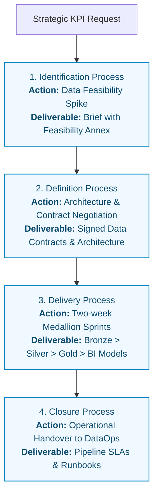
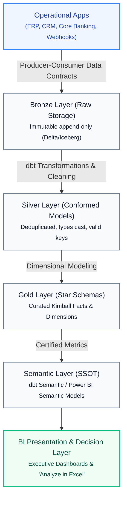

> [!NAV] Navigation
> **Vault**: [[00 - Praxis Framework Overview|Praxis Overview]] > **Section**: Data & BI Practitioner Guide
> **Pillar**: Specialization | **Type**: `handbook`

# Praxis for Data & Business Intelligence: The Practitioner's Guide

## Bridging Project Governance with the Modern Data Stack

Standard project management frameworks (PMBOK, PRINCE2) were designed for deterministic, physical, or generic software systems. When applied to enterprise **Data Engineering, Data Analytics, and Business Intelligence (BI)** projects, they frequently break down.

Data projects possess unique physics that generic frameworks ignore:
- **Uncertainty of Material**: In software, requirements dictate code. In data, you cannot build what the raw data does not support. Data feasibility and historical depth dictate what is deliverable.
- **Silent Corruption**: Software bugs trigger error codes or crash the UI. Data bugs fail silently—a misplaced join or bad character encoding produces a valid-looking dashboard with quietly inaccurate numbers, misleading executive decisions.
- **Upstream Entropy (Schema Drift)**: Data systems are downstream consumers of operational applications (ERP, CRM, billing). When upstream developers alter a column or API schema without notice, downstream pipelines break.
- **Elastic Cloud Consumption**: Compute is no longer a fixed on-premises server cost. Unoptimized queries on Snowflake, Databricks, or BigQuery can exhaust thousands of dollars in hours without governance.
- **The "Excel Addiction" Fallback**: Business users have an entrenched, frictionless alternative. If a new BI platform is slow or rigid, users copy-paste numbers into desktop spreadsheets, abandoning the certified platform.

**Praxis for Data & BI** solves these dilemmas by integrating the four pillars of the Praxis Framework directly into modern Lakehouse, DataOps, and Analytics architectures.

---

## The Four Pillars Adapted for Data & Analytics

```
┌──────────────────────────────────────────────────────────────────────────────────────────────────┐
│                             PRAXIS FOR DATA & BUSINESS INTELLIGENCE                              │
└────────────────────────────────────────────────┬─────────────────────────────────────────────────┘
                                                 │
         ┌───────────────────────────────┬───────┴───────────────────────┬─────────────────────────┐
         ▼                               ▼                               ▼                         ▼
┌──────────────────┐           ┌──────────────────┐           ┌──────────────────┐       ┌─────────────────┐
│   1. Knowledge   │           │    2. Method     │           │  3. Competence   │       │   4. Maturity   │
│  Management for  │           │   Life Cycle &   │           │   Specialized    │       │ 5-Level DataOps │
│    Data Teams    │           │ Medallion Sprints│           │ Modern Roles     │       │    Evolution    │
└────────┬─────────┘           └────────┬─────────┘           └────────┬─────────┘       └────────┬────────┘
         │                              │                              │                          │
         ├─► Data FinOps                ├─► Data Spikes (ID)           ├─► Platform Eng           ├─► L1: Excel Hell
         ├─► Data Contracts             ├─► Data Contracts (DEF)       ├─► Analytics Eng          ├─► L2: Managed Git
         ├─► DataOps Testing            ├─► Medallion Cadence (DEL)    ├─► BI Developer           ├─► L3: Lakehouse
         └─► Adoption Strategy          └─► Ops Handover (CLO)         └─► Data Steward           └─► L4-5: DataOps
```

### Pillar 1: Knowledge (The 10 Management Areas for Data)

Praxis functional management areas are enriched with concrete data platform practices:

1. **[[Scope Management]]**: Managing the boundary between Bronze (raw), Silver (cleansed), and Gold (curated) layers; establishing dimensional star schemas (Kimball) versus One Big Table (OBT); enforcing Producer-Consumer Data Contracts.
2. **[[General Principles of Financial Management|Financial Management & FinOps]]**: Governing consumption-based cloud compute; managing Databricks DBUs and Snowflake virtual warehouse auto-suspend timers; tracking unit cost per query and pipeline run.
3. **[[General Principles of Risk Management|Risk Management]]**: Mitigating the 5 primary data risks: upstream schema drift, silent corruption, batch window SLA breaches, unmasked PII exposure, and dashboard abandonment.
4. **[[Control|Quality Management & DataOps]]**: Implementing automated testing gates across the 6 universal data quality dimensions (freshness, completeness, uniqueness, validity, accuracy, consistency) using dbt test suites and Great Expectations.
5. **[[Goal of Change Management|Change Management & Adoption]]**: Overcoming user inertia; graduating business analysts from desktop spreadsheets to governed "Analyze in Excel" live connections and certified Power BI/Tableau semantic models.
6. **[[General Principles of Resource Management|Resource Management]]**: Aligning specialized talent (Data Engineers, Analytics Engineers, BI Developers, Data Stewards) and orchestrating elastic cloud compute pools.

---

### Pillar 2: Method (The Iterative Data Life Cycle)

The Praxis life cycle adapts into an agile, continuous data delivery engine:



---

### Pillar 3: Competencies (Modern Data Roles)

Praxis competence criteria mapped to modern data engineering specialties:

- **Data Project Manager / Data Product Owner**: Translates executive business questions into technical data modeling requirements; manages cross-functional dependencies between source systems, platform engineers, and business analysts.
- **Data Platform Engineer**: Focuses on ingestion resilience, change data capture (CDC), distributed Spark compute, storage partitioning, networking, and cluster scalability.
- **Analytics Engineer**: Bridges backend engineering and frontend reporting; owns dbt transformation models, Kimball dimensional star schemas, primary/foreign key assertions, and semantic metric calculations.
- **BI / Visualization Developer**: Focuses on the user experience; designs intuitive DAX/Tableau measures, dashboard layouts, cross-filtering interactions, mobile layouts, and Row-Level Security (RLS).
- **Data Governance Steward**: Curates business glossaries, enforces data catalog classifications in Unity Catalog or Microsoft Purview, and oversees regulatory compliance (GDPR, HIPAA, CCPA).

---

### Pillar 4: The 5-Level Data & BI Capability Maturity Model

Praxis benchmarks organizational maturity across five distinct stages:

```
Level 1: Ad-Hoc / "Excel Hell"
└── Local desktop spreadsheets, manual CSV extracts, unversioned SQL scripts, conflicting departmental numbers.

Level 2: Managed
└── Project-level Git repositories, basic scheduled batch jobs, documented reporting requirements, standard BI workspace workspaces.

Level 3: Defined Enterprise Lakehouse
└── Standardized Medallion Architecture (Bronze/Silver/Gold), enterprise semantic layer, centralized metadata catalog, automated CI/CD deployment pipelines.

Level 4: Quantitatively Managed DataOps
└── Automated data quality test gates (dbt test / Great Expectations), pipeline observability metrics (freshness SLAs, downtime), FinOps cluster cost accounting.

Level 5: Optimizing / Autonomous Data Mesh
└── Self-healing data pipelines, automated schema drift quarantine, federated domain data product ownership, real-time streaming decision intelligence.
```

---

## End-to-End Implementation Architecture

The modern data practitioner delivers value through an integrated pipeline where governance, architecture, and reporting intersect:



---

## The Data Project Manager's Artefact Toolkit

This vault includes fully pre-populated, production-ready artefacts customized for analytics initiatives:

| Artefact Note | Purpose in Data & BI Initiatives |
| :--- | :--- |
| **[[Product Documents]]** | Contains templates for **Producer-Consumer Data Contracts** (`contract.yaml`), **dbt Model & Metric Specifications** (`schema.yml`), and **BI Dashboard Design Briefs**. |
| **[[Risk Register]]** | Pre-populated with real-world technical failure modes: upstream schema drift, silent corruption, batch SLA breaches, unmasked PII, and dashboard abandonment. |
| **[[Issue Register]]** | Structured DataOps incident log categorized by P1 to P4 priority tiers with root-cause remediation and automated regression test protocols. |
| **[[Control Management Plan]]** | Defines continuous pipeline freshness SLAs, dbt test failure error budgets, Snowflake/Databricks FinOps credit caps, and BI visual response budgets. |
| **[[04. Management Areas/Cost Management/General Principles of Financial Management|Financial Management]]** | Enterprise guide to cloud consumption governance, virtual warehouse sizing, and unit economics. |
| **[[04. Management Areas/Change Management/Goal of Change Management|Change Management]]** | Comprehensive framework for overcoming Excel inertia, driving user adoption, and conducting data literacy workshops. |

---

## Summary: The Praxis Advantage for Data Leaders

By grounding data delivery in the **Praxis Framework**:
1. **You eliminate the "black box" of data engineering**: Technical workflows (dbt, Spark, SQL) are bound to transparent project governance, life cycle stage gates, and executive business cases.
2. **You guarantee data trust**: Quality is not an afterthought checked in reports; it is verified across four automated gates from ingestion to presentation.
3. **You secure actual business adoption**: By pairing technical delivery with deliberate change management and spreadsheet deprecation strategies, your dashboards become indispensable daily operational tools rather than abandoned shelfware.
